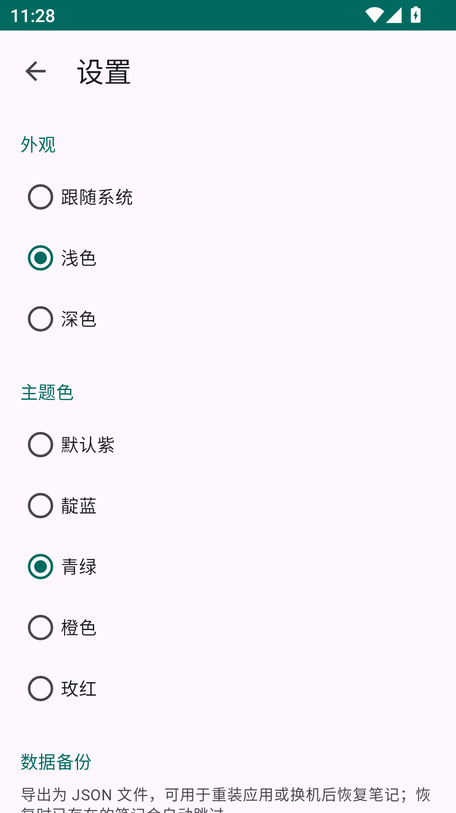

# NotePad 记事本

基于 Google 早期 NotePad 示例（ContentProvider + SQLite）扩展的 Android 记事本，保留原示例的数据访问骨架，在其上完成了时间戳、搜索、分类、收藏、回收站、待办、置顶、主题与备份等功能。

## 功能

**基础要求**

- 列表条目显示时间戳：今天 / 昨天 / 日期（`TimeFormatter`）
- 按标题或正文搜索，条件为 `(title LIKE ? OR note LIKE ?)`
- 搜索命中的关键词在标题与摘要中高亮显示（`SpannableString` + `ForegroundColorSpan`）

**扩展功能**

| 功能 | 说明 |
|---|---|
| 笔记分类 | 内置默认 / 工作 / 学习 / 生活，顶部 Chip 可自定义新增 |
| 收藏 | 长按收藏，卡片显示 ★，可用「收藏」Chip 筛选 |
| 最近删除 | 软删除进入回收站，支持恢复、彻底删除、清空 |
| 待办 | 卡片左侧复选框，勾选后标题加删除线，「待办」Chip 筛选 |
| 置顶 | 长按「置顶」，卡片显示置顶标签，排序按 `pinned DESC, modified DESC` |
| 主题 | 跟随系统 / 浅色 / 深色，另有 5 套主题色 |
| 导出与恢复 | JSON 文件，SAF 选择路径，无需存储权限，恢复时自动去重 |
| 粘贴新建 | 从剪贴板内容创建笔记 |

## 截图

| 列表 | 深色模式 |
|---|---|
|  |  |

| 设置（主题与备份） | 待办完成态 |
|---|---|
|  |  |

## 技术栈

- 语言：Java 17
- UI：AndroidX AppCompat、Material Components 3、RecyclerView
- 数据：SQLite + ContentProvider + CursorLoader
- 偏好：SharedPreferences
- 构建：Gradle 8.13、AGP 8.12.2，compileSdk 36，minSdk 24

## 项目结构

```
NotePad/
├── app/src/main/
│   ├── AndroidManifest.xml
│   ├── java/com/notepad/app/
│   │   ├── NotePad.java              数据契约：表名、列名、URI、MIME
│   │   ├── NotePadProvider.java      数据入口：路由 + 增删改查 + 迁移
│   │   ├── NotePadApp.java           启动时应用主题
│   │   ├── NotesList.java            列表、搜索、筛选、回收站
│   │   ├── NoteEditor.java           编辑、草稿、分类、收藏
│   │   ├── TitleEditor.java          标题编辑对话框
│   │   ├── NoteListAdapter.java      Cursor → 卡片，含关键词高亮
│   │   ├── SettingsActivity.java     主题、主题色、备份
│   │   ├── BackupManager.java        JSON 导出与恢复
│   │   ├── ThemePrefs.java           主题偏好
│   │   ├── TimeFormatter.java        时间显示
│   │   └── LinedEditText（嵌套类）    带横线的编辑器
│   └── res/                          布局、菜单、文案、主题、颜色
└── app/src/androidTest/java/...      仪器测试
```

## 数据库

数据库版本 **6**，两张表。

**notes**

| 列 | 类型 | 说明 |
|---|---|---|
| `_id` | INTEGER | 主键 |
| `title` | TEXT | 标题 |
| `note` | TEXT | 正文 |
| `created` | INTEGER | 创建时间（毫秒） |
| `modified` | INTEGER | 修改时间（毫秒），默认排序字段 |
| `category` | TEXT | 分类名 |
| `is_favorite` | INTEGER | 收藏标记 |
| `deleted_at` | INTEGER | 软删除时间，0 表示未删除 |
| `is_todo` | INTEGER | 是否待办 |
| `is_done` | INTEGER | 待办是否完成 |
| `pinned` | INTEGER | 置顶标记，1 时排在列表最前 |

**categories**：`_id`、`name`（唯一）、`sort_order`

版本升级采用 `ALTER TABLE` 增量迁移，不清空旧数据：v3 加分类/收藏/软删除，v4 建分类表，v5 加待办字段，v6 加置顶字段。

URI 契约保持不变：

```
content://com.google.provider.NotePad/notes
content://com.google.provider.NotePad/notes/#
content://com.google.provider.NotePad/categories
content://com.google.provider.NotePad/categories/#
```

## 构建与运行

环境要求：JDK 17、Android SDK Platform 36。

Android Studio：打开 **NotePad 根目录**（不是 `app`），等待 Gradle Sync 完成后直接 Run。

命令行：

```bash
./gradlew assembleDebug
adb install -r app/build/outputs/apk/debug/app-debug.apk
adb shell am start -n com.notepad.app/.NotesList
```

## 测试

```bash
./gradlew connectedDebugAndroidTest
```

共 10 条用例：

- `NotePadProviderTest`（6 条）：插入查询、更新、软删除过滤、待办状态切换、物理删除、重复分类拒绝
- `TimeFormatterTest`（4 条）：今天、昨天、月日、跨年

> 注意：`connectedDebugAndroidTest` 结束后会自动卸载应用，本地数据会被清空。有重要数据时先用设置页导出 JSON。

## 架构

三条贯穿全局的规则：

1. **写只走 Provider**：界面从不直接操作 SQLite。
2. **读只走 Loader**：查询在后台线程执行，Cursor 生命周期由 Loader 管理。
3. **刷新只靠通知**：写库后 `notifyChange`，订阅该 URI 的 Loader 自动重查。

一次保存的完整链路：

```
NoteEditor.onPause
  → updateNote
    → 草稿：Provider.insert / 已有：Provider.update
      → notifyChange(notes)
        → CursorLoader 重新查询
          → Adapter 重新绑定 → 列表刷新
```

## 已知限制

- 分类只支持新增，不支持重命名与删除（`category` 存的是名称字符串）
- 搜索没有做防抖，每次输入都会查询
- 置顶只在默认排序下生效，按分类或收藏筛选时同样排在组内最前
- 回收站没有自动清理机制，需要手动清空
- 编辑器首次读取笔记在主线程（原示例遗留）

## 说明

本项目以 Google NotePad 示例为起点做扩展，保留了 `ContentProvider + SQLite` 的数据访问方式与原有 URI 契约；UI、筛选、主题、备份等均为后续实现。
